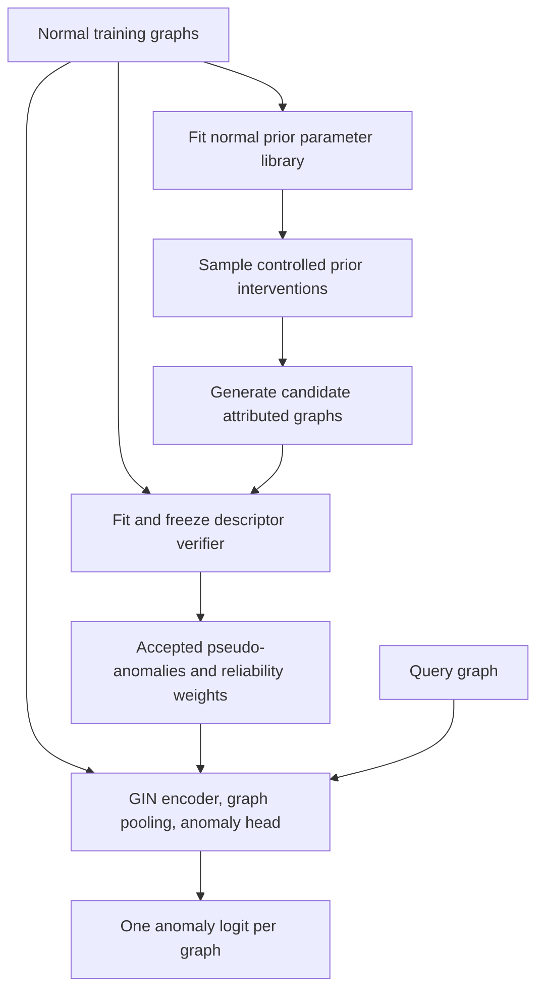

# GRAFT-AD: Graph-prior Adaptation for Graph-level Anomaly Detection

**Status:** experimental candidate implemented as `graft_ad`. This document
describes the research design and the initial local implementation. No model
tests, training, evaluation or terminal UI execution have been performed.
Syntax, configuration composition and static planning checks do not establish
runtime correctness or performance.

**Core idea:** adapt GraphPFN's synthetic graph prior to normal training graphs,
then intervene on its structural and attribute mechanisms to generate diverse,
controlled pseudo-anomalies. Train a graph-level detector to separate observed
normals from these screened synthetic negatives.

## 1. Motivation and research question

Normal-only graph anomaly detection has no observed anomalies for training.
Generated negatives can supply a learning signal, but easy corruptions may teach
shortcuts, while small perturbations may still be normal. GRAFT-AD makes the
generation mechanism and its intervention strength explicit, and treats negative
labels as uncertain surrogate supervision.

The research question is: **does a normal-adapted graph prior with controlled
interventions produce more useful training negatives than random corruption or
diffusion-generated negatives under the same evaluation protocol?**

This follows the generation, anomaly-scale and boundary questions in the
[research presentation](../../1013/presentation/main.tex). It is a standalone
candidate alongside [AGDiff](agdiff.md); an AGDiff component replacement can be a
later controlled experiment.

## 2. What is borrowed from GraphPFN

The reference is [GraphPFN, arXiv:2509.21489v4](https://arxiv.org/html/2509.21489v4),
especially Sections 4.1–4.2. Its structure prior combines degree-corrected SBMs
at two levels: first-level graphs are united with a second-level graph through
a random node bijection. Preferential attachment subsequently adds peripheral
nodes with randomly sampled initial degrees. Its attribute prior uses random
neural SCMs with mixed MLP/GNN neurons and optional degree/PageRank inputs.

GraphPFN's predictor performs node-level tasks. GRAFT-AD reuses the **prior
construction**, then introduces normal-data adaptation, interventions, screening
and graph-level discrimination. These additions are proposed here. A GraphPFN
prediction checkpoint is not a conditional graph sampler, and using its prior
does not make this detector a PFN or provide Bayesian predictive guarantees.

The first version requires neither GraphPFN predictor weights nor PFN
pretraining. Its output is a collection of independent attributed graphs,
each with a single anomaly score.

## 3. Task and architecture

Let the normal training collection be
$\mathcal D_N=\{G_i=(A_i,X_i)\}_{i=1}^{N}$. Learn a score $s_\theta(G)$ with
larger values indicating greater anomaly evidence. Real anomaly labels enter
only the final evaluation.



The prior and verifier use training normals only. They are frozen before
detector training so the detector cannot redefine which generated graphs are
accepted. At inference, only the trained detector is needed.

## 4. Adapt the prior to normal graphs

Represent generation as

$$
\phi\sim q_N(\phi),\qquad
A=\operatorname{Struct}(\phi_s,\epsilon_s),\qquad
X=\operatorname{Attr}(A,\phi_x,\epsilon_x).
$$

$\phi_s$ controls blocks, connectivity, degree heterogeneity, overlap and
peripheral-node attachment; $\phi_x$ controls the attribute mechanism.
$\epsilon$ denotes random sampling. $q_N$ is a proposed empirical parameter
distribution adapted to $\mathcal D_N$, not an exact posterior.

For an initial implementation, use a parameter library with descriptor-based
approximate matching:

1. Extract graph descriptors: size, density, degree quantiles, clustering,
   component fractions, approximate community statistics, feature marginals
   and neighborhood-feature agreement. Define finite values for singleton and
   edgeless graphs; use bounded sampling for expensive statistics.
2. Fit descriptor scaling and local neighborhoods on training normals. Drop
   constant dimensions. Preserve multiple normal modes using local matches
   rather than one global average graph.
3. Sample prior parameters, generate graphs and retain parameter settings
   whose descriptors match an anchor normal within a fixed tolerance. Store
   several matches per anchor where possible. All tolerances and budgets are
   fixed before final evaluation.
4. Resample retained settings with modest bounded variation to define $q_N$.
   Record match distances and failed anchors. If the prior cannot represent a
   normal mode, report that failure; widening acceptance silently would hide
   a generator mismatch.

Condition generation on an anchor's node count, including the final count
after peripheral attachment. Match non-intervened statistics where feasible.
This limits trivial discrimination by size or density while allowing a chosen
structural property to change deliberately.

### Attribute schema

The adapted SCM must produce the framework's `input_dim` and feature types.
Map continuous outputs using training-normal marginal statistics. For known
categorical/one-hot groups, sample valid categories with training-derived
frequencies and structure dependence; do not emit arbitrary continuous vectors
into categorical columns. Schema information must come from declared metadata
or training data, without fitting on held-out graphs.

For featureless datasets, regenerate `[1, log(1 + degree)]` from each generated
graph, as required by the [shared feature policy](protocol.md). Independent
attribute interventions are disabled in this case. Molecular validity requires
additional domain constraints; matching unweighted topology and node features
does not establish chemically valid generation.

## 5. Generate controlled pseudo-anomalies

Sample an anchor and its matched parameter setting, choose an intervention
family $t$ and strength $\alpha$, then draw

$$
\widetilde\phi=T_{t,\alpha}(\phi),\qquad
\widetilde G\sim p(\cdot\mid\widetilde\phi).
$$

Use shared random seeds for paired strengths when possible, so nuisance
variation does not dominate the intended intervention. Parameter strengths
are measured in training-derived scales and clipped to valid ranges.

| Family | Proposed intervention | Control against easy shortcuts |
|---|---|---|
| Community structure | Change within/between-block edge odds or overlap | Approximately match node and edge counts |
| Degree and periphery | Change degree concentration or attachment allocation | Match final size and approximately mean degree |
| Attributes | Shift selected continuous mechanisms or categorical conditionals | Preserve declared feature domains |
| Structure–attribute coupling | Weaken/reverse neighborhood dependence or reassign attribute roles | Approximately preserve attribute marginals and graph structure |
| Mixed | Apply two individually bounded interventions | Cap total descriptor displacement |

For topology interventions, generate attributes conditional on the new topology.
For coupling interventions, change the relationship explicitly. Any
topology-derived input feature must remain consistent with the resulting graph.
Never use GraphPFN's generated node targets as real graph anomaly labels.

Sample mild, moderate and strong interventions across families. Strength is an
interpretable **generation control**, not a proven ordering of semantic
anomaly severity. Record both requested strength and realized descriptor change.

## 6. Screen negatives without claiming ground truth

A graph different from its anchor can resemble another normal mode. Screen
against the entire training-normal descriptor bank, not just the anchor.
For scaled descriptors $\bar d$, define

$$
r(G)=\frac{1}{k}\sum_{j\in\mathcal N_k(G;\mathcal D_N)}
\|\bar d(G)-\bar d(G_j)\|_2.
$$

Use leave-one-out distances for training normals, excluding the graph itself.
Fix two training-derived quantiles $\tau_{\mathrm{near}}<\tau_{\mathrm{far}}$
before generation. These are generation gates, separate from the framework's
held-out calibration threshold.

- Reject candidates violating representation or domain constraints.
- Discard candidates with $r\leq\tau_{\mathrm{near}}$ from negative supervision:
  they may be normal or ambiguous. Do not relabel them as positives.
- Give candidates in the intermediate band a bounded reliability weight,
  increasing with distance, for example
  $w(G)=\operatorname{clip}((r-\tau_{\mathrm{near}})/
  (\tau_{\mathrm{far}}-\tau_{\mathrm{near}}),0,1)$.
- Retain a capped fraction beyond $\tau_{\mathrm{far}}$ as easy negatives;
  prevent them from dominating each family or minibatch.

Near/far refer to this descriptor geometry. The gate cannot certify semantic
anomalies or eliminate all mislabeled negatives. It may also miss anomalies
that preserve its descriptors. If the bank is too small, distances degenerate,
or an intervention yields no accepted samples within its proposal budget,
report the condition and skip that family. If no family is usable, fail the
candidate fit explicitly rather than silently substitute another detector.

Track acceptance rate, weights, normal-mode coverage, descriptor displacement
and intervention-family coverage. Compare unperturbed synthetic graphs with
real normals using an internal train-only diagnostic split. Strong separation
by a simple source classifier indicates that synthetic artifacts could explain
the detector's success. Unperturbed synthetic samples are diagnostic controls,
not trusted normal supervision in the initial model.

## 7. Detector and objective

Use a GIN node encoder with concatenated mean/max graph pooling and an MLP
head. Let $\ell_\theta(G)$ be its anomaly logit. Avoid normalization that uses
other query graphs at evaluation time.

Train real normals as label 0 and screened pseudo-anomalies as surrogate label
1 using a family-balanced weighted logistic objective:

$$
\mathcal L_{\mathrm{cls}}=
\mathbb E_{G\sim\mathcal D_N}\operatorname{softplus}(\ell_\theta(G))
+\lambda_{\mathrm{neg}}
\frac{\sum_j w_j\operatorname{softplus}(-\ell_\theta(\widetilde G_j))}
     {\max(\sum_j w_j,\varepsilon)}.
$$

An optional ranking term compares an accepted synthetic graph to its anchor:

$$
\mathcal L_{\mathrm{rank}}=
\mathbb E_{(G,\widetilde G)}w(\widetilde G)
\max\{0,m+\ell_\theta(G)-\ell_\theta(\widetilde G)\}.
$$

Start with $\mathcal L_{\mathrm{cls}}$ alone; evaluate ranking separately.
Do not force logits to increase with every sampled $\alpha$, since the
intervention may traverse a different normal mode. Generation and rejection
sampling are outside the gradient path; no differentiable graph decoder is
required.

Inference returns $s(G)=\ell_\theta(G)$. This is a discriminative score against
the chosen synthetic alternatives, not a calibrated probability of real
anomaly membership. There is no graph generation or test-set adaptation during
scoring.

## 8. Training and evaluation protocol

1. Obtain the repository's fixed split. Use only normal training graphs for
   prior adaptation, scaling, the verifier and detector fitting.
2. Fit and freeze the parameter library and verifier. Generate a seeded pool
   with bounded proposal counts and family quotas; retain generation metadata.
3. Train the detector for a fixed final epoch budget. Do not select checkpoints
   using calibration graphs or real anomaly labels.
4. Use held-out normal calibration scores only for the shared 99th-percentile
   operating threshold.
5. Evaluate once on remaining normals and all held-out anomalies. Report AUROC,
   anomaly-positive AP and thresholded F1, with paired splits/seeds matching
   the baselines. Also report generation cost, acceptance rates and inference
   latency/memory separately.

These steps follow [protocol.md](protocol.md). Any development split used for
generator diagnostics must be internal to training; it cannot repurpose the
framework calibration set for model selection.

## 9. Experiments that test the mechanism

Keep the detector architecture, preprocessing, split and training budget fixed
when comparing negative generators.

| Comparison or ablation | Question |
|---|---|
| Random edge/feature corruption and simple size/density-matched random graphs | Does the adapted prior add useful information? |
| Unadapted versus normal-adapted prior | Does normal matching reduce synthetic artifacts? |
| Each intervention family, then their mixture | Which structural or attribute changes transfer? |
| No gate versus distance gate; easy-only versus mixed distances | Does screening improve learning beyond easy-negative separation? |
| Fixed strength versus several strengths | Does controlled diversity help? |
| Logistic loss versus added ranking | Is pairwise supervision beneficial? |
| Same detector trained with AGDiff-generated negatives, if exportable | Does generation help independently of detector changes? |
| Full AGDiff and the nine registered benchmarks | Is the complete candidate competitive under the shared protocol? |

Inspect scores by graph size, density and normal mode. A descriptor-only detector
and a size/density-only classifier reveal whether the learned GNN adds value.
Evaluate separately across molecular, biological and social graph datasets.
Use paired per-seed differences and disclose failed runs. Strong accuracy on
synthetic negatives alone is not evidence of real anomaly detection quality.

## 10. Repository integration

The initial implementation is registered through
[`configs/models/graft_ad.yaml`](../configs/models/graft_ad.yaml) and consists of:

```text
configs/models/graft_ad.yaml
src/models/candidates/graft_ad.py
src/models/candidates/graft_ad_config.py
src/models/candidates/graft_ad_impl/
    graph.py       # undirected graph inputs and bounded sparse descriptors
    features.py    # training-only schema and random graph-aware neural SCM
    prior.py       # normal-adapted parameter library and attributed graph sampling
    interventions.py
    generation.py  # bounded family pools, paired controls and easy-negative quotas
    verifier.py
    detector.py
```

Select **graft_ad** under the terminal UI's **Methods**, then use
**Hyperparameters > Model > graft_ad**. The saved
[`graft_ad_vs_benchmarks.json`](../experiments/graft_ad_vs_benchmarks.json)
profile selects GRAFT-AD, AGDiff and the nine benchmarks across 12 datasets and
five seeds (660 jobs). Opening it starts no experiments. Set the experiment
interpreter to the project's CUDA environment before starting a run.

The equivalent single-run selection is `python -m src.train model=graft_ad`.
This command trains and calibrates; it is provided for future use and was not
executed for this implementation.

### Initial implementation choices

- **Prior:** an independent, sparse two-level degree-corrected Poisson SBM
  construction with duplicate/self-edge removal and degree-plus-one preferential
  attachment. Edge event counts and attachment degrees are random; the observed
  edge count is an approximate target. First-level partitions and second-level
  bijections are sampled, then retained by descriptor matching. This is a local
  adaptation of the paper's construction, not copied official generation code.
- **Attributes:** a small random neural SCM with mixed node-local and mean-neighbor
  neurons, a degree input, and empirical marginal remapping. Native binary
  columns, declared categorical columns and one-hot groups stay discrete. The
  unperturbed prior preserves training-observed one-hot category support. The
  first implementation does not use PageRank or all aggregation types from the
  source paper. `features.mode=auto` recognizes the shared degree encoding only
  when every supplied training graph matches it. Use `native` to override this
  inference. One-hot-tail inference is based on all training graphs; explicit
  groups take precedence. Other categorical columns require explicit indices.
  Automatic regeneration of topology-derived inputs covers the shared two-column
  degree encoding; additional derived native columns need a future schema extension.
- **Descriptors:** log size, density, log-degree quantiles, isolated-node and
  largest-component fractions, bounded wedge-based clustering estimates, feature
  means/stds and edge-feature differences. There is no separate community-fitting
  algorithm or motif counter. Constant descriptor dimensions are dropped.
- **Generation:** each proposal and its unperturbed control share a sampling
  seed. By default the control must pass the near-normal gate and the anchor
  matching tolerance. Exact no-ops, negligible descriptor changes and changes
  above `max_descriptor_displacement` are rejected. Coupling interventions
  permute a fraction of native feature rows, preserving their marginals. No
  independent attribute/coupling family is enabled for degree-derived features.
- **Quotas:** the easy-negative fraction is enforced on the actual retained
  pool of each family, including partially filled pools. Families below the
  minimum count are skipped and logged; no usable family causes an explicit
  fit failure. The generator never silently widens its gate or matching tolerance.
- **Detector:** GIN layers with node-local LayerNorm, concatenated mean/max
  pooling from all layers and an anomaly-logit head. Feature normalization is
  fitted on a bounded uniform reservoir of training nodes. Weighted logistic
  loss is balanced over represented families. Anchor ranking is optional.
- **Inputs and execution:** all graph inputs are canonicalized as simple,
  unweighted, undirected graphs; self loops and duplicate edges are removed.
  Edge attributes and direction are outside this implementation. The supplied
  training loader is consumed once and its graph inputs cached; its backing
  dataset and labels are never inspected. Prior sampling/descriptors use NumPy
  and SciPy on the host, while neural training/scoring use the selected device.
  The framework still enforces CUDA for training and evaluation.

The implementation records generator acceptance and unperturbed-control
distances, but does not automatically fit the proposed source classifier or
run the ablation studies. Domain-specific molecular validity constraints and
comparisons with alternative generators remain research work.

| Setting | Default |
|---|---:|
| GIN hidden width / layers | 64 / 3 |
| Prior anchor limit / matches per anchor | 32 / 2 |
| Matching attempts per anchor / tolerance | 16 / 2.5 |
| Verifier neighbors / near and far quantiles | 5 / 0.8 and 0.98 |
| Target negatives per family / proposal budget | 32 / 256 |
| Minimum retained per family / easy fraction | 4 / 0.25 |
| Strengths | 0.25, 0.75, 1.5 |
| Detector epochs / learning rate | 100 / 0.001 |
| Ranking loss weight | 0 (disabled) |

These are development defaults, not tuned or runtime-validated settings. The
verifier requires at least two training graphs, varying descriptors and distinct
near/far quantiles. Degenerate normal collections or poor prior coverage can
fail explicitly. Final real minibatches may still contain just one graph.

The adapter must follow [BaseAnomalyModel](../src/models/base_model.py):
`fit(train_loader, config, device)`, `anomaly_score(batch)`, `state_dict()` and
`load_state_dict(state)`. Return one finite score per graph and preserve scores
when a query is scored alone or in a different batch. Handle variable sizes,
isolated nodes, edgeless graphs and singleton minibatches on the selected device.

Checkpoint detector weights, preprocessing state, verifier references, retained
prior settings, intervention configuration and seeds as tensors and standard
containers compatible with `weights_only=True`. Record generator provenance
and pool hashes with run artifacts. Expose matching budgets, descriptor choices,
intervention ranges, gate quantiles, family quotas and loss weights in YAML.

The [official GraphPFN repository](https://github.com/yandex-research/graphpfn)
provides generation code under `paper/lib/graphpfn/prior`. Its package currently
requires Python 3.11+ and pins PyTorch below 2.5, while GLAD Lab specifies Python
3.10 and PyTorch 2.5.1. Inspect prior-only dependencies before choosing an
integration route if replacing the local prior. The current implementation uses
the existing NumPy/SciPy/Torch/PyG dependencies and does not import `graphpfn`,
DGL or predictor weights. No dependency pins were changed. If upstream code is
adopted later, preserve its notices and pin a revision; package installation is
not a drop-in integration with the current environment.

## 11. Validation milestones and limits

1. **Generator feasibility:** establish normal-descriptor coverage and feature
   validity with bounded runtime, including small and large graphs.
2. **Minimal candidate validation:** verify two-level structure generation,
   feature-schema adaptation, structural/coupling interventions, the frozen
   descriptor gate, checkpoint round trips and batch-independent detector scores.
3. **Mechanism validation:** compare equal-budget generators and inspect source
   artifacts, ambiguous negatives and normal-mode rejection.
4. **Full comparison:** add intervention mixtures and optional ranking, then run
   the shared benchmark protocol after development choices are frozen.

The central uncertainty is whether prior-induced deviations resemble unseen
real anomalies. Normal-only data cannot resolve that identification problem.
Small molecular graphs may poorly match the community/periphery prior; exact
motif calculations and dense SBM sampling may be expensive on large graphs;
descriptor screening may exclude rare valid normals. Sparse sampling, bounded
statistics and mode-aware matching need explicit evaluation. No superiority
over AGDiff or other methods is assumed.
